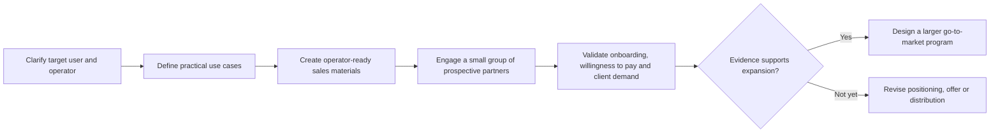

# Exploring Market Readiness for a Digital Security Product

### Market-entry exploration, product positioning and operator-led go-to-market recommendations

*Anonymized case study | February–April 2025 | Marketing & market-entry engagement*

> **The challenge:** A technically sophisticated product for protecting and recovering sensitive digital information needed more than a security narrative to win professional intermediaries. The immediate question was how to translate its architecture into a proposition that legal and wealth-advisory professionals could understand, integrate into their practice and justify commercially.
>
> **My contribution:** Working directly with the founder, I assessed barriers to adoption, challenged the initial technology-led narrative, explored market and distribution options, produced a commercial one-pager and a completed sales pitch deck, and opened conversations with prospective professional partners.
>
> **Outcome boundary:** This was an exploratory, pre-commercial engagement. I do not claim signed customers, revenue, a completed pilot or deployed recommendations.

| Dimension | Scope |
|---|---|
| Role | Marketing and market-entry contributor, working directly with the founder |
| Business | Early-stage digital security and sensitive-information recovery technology |
| Audience explored | Legal professionals and other trusted intermediaries; adjacent private-wealth and financial-service use cases |
| Markets examined | France and selected North American professional networks |
| Confirmed deliverables | Commercial one-pager; sales pitch deck completed and delivered to the founder; analysis of minimum requirements to secure an operator |
| Additional work documented | Stakeholder outreach, prospective partner discussions, positioning, packaging and go-to-market recommendations |
| Commercial status | No sales confirmed during the engagement |

## 1. The market-entry problem

The technology was designed around confidentiality, secure handling of sensitive information and controlled recovery. Those characteristics were central to the founder's vision. But they did not, by themselves, answer the practical questions of a lawyer or other trusted professional considering whether to act as an operator or recommend the solution to clients.

In the model explored, an **operator** was a trusted professional who would help clients use the solution and participate in its secure recovery process.

My prior experience in digital assets and professional-services markets suggested a recurring adoption gap: professionals first needed to understand **what problem the service addressed, what their responsibilities would be, how they would introduce it to clients, and whether the economics justified the additional work**.

I therefore approached the assignment as a commercial-readiness and market-entry problem, not simply a request for more promotional material.

### Questions that shaped the work

- Who was the actual buyer, user and intermediary, and were they necessarily the same person?
- Which use cases justified a high-assurance product rather than an existing, simpler alternative?
- What would persuade a professional to take on the operator role?
- How could onboarding and distribution support adoption without undermining the product's security requirements?
- What should be validated with early adopters before investing in a larger sales operation?

These were working hypotheses and strategic questions, not conclusions from a representative customer study.

## 2. Translating technical value into a professional proposition

One of my central recommendations was to shift the emphasis from technical features alone to **practical value for a professional practice**.

| Technology-first explanation | Commercial question to answer |
|---|---|
| Sophisticated security and controlled access | What specific client situation does this solve? |
| Specialized operating environment | How would a professional use and explain the service? |
| Long-term protection of sensitive information | Why would clients and their advisers trust it over alternatives? |
| A proposed operator license | What services could the practice reasonably provide, and what would justify the cost? |

This reframing led to recommendations for a clear pitch, practical use cases, educational content and an operator-oriented proposition. The goal was not to promise automatic revenue, but to give prospective partners a credible explanation of **responsibilities, benefits, implementation effort and potential commercial value**.

**Confirmed outputs:** I completed the initial commercial one-pager, developed and delivered a sales pitch deck to the founder, and documented the minimum requirements for securing a first professional operator. Additional educational assets were proposed; their completion or deployment is not established.

## 3. Challenging the packaging and distribution model

The discussions exposed a genuine product-market tension: a tightly controlled technical setup could reinforce the product's security positioning while adding cost, onboarding friction and logistical complexity.

I explored possible ways to address that tension without assuming that greater accessibility was automatically compatible with the intended security model.

### Options considered

| Strategic option | Potential advantage | Critical trade-off |
|---|---|---|
| Dedicated, controlled device | Consistent operating environment and premium presentation | Hardware, logistics and onboarding burden |
| More accessible software distribution | Easier access and potentially simpler trials | Security and technical constraints requiring founder validation |
| License-only operator model | A more software-led operating model | Unclear immediate value for professionals unfamiliar with the category |
| License combined with enablement | Education, client-facing materials and structured onboarding | Additional operational work and possible pressure on scalability |

I also recommended considering the *experience* surrounding the product: professional-facing explanations, tailored onboarding, a premium presentation and a clearer client journey. These were **proposals**, not product features I owned or shipped.

The central recommendation was to test whether a supported operator offering could reduce adoption friction while preserving the founder's technology-first vision.

## 4. Exploring the market through professional relationships

I used my existing knowledge of legal and digital-asset markets to identify prospective intermediaries, initiate conversations and explore adjacent opportunities across professional and financial-services networks.

One concrete outcome was **engagement with a prospective lawyer partner in North America** who expressed interest in a more detailed presentation. The discussion surfaced an important condition: the professional wanted a real end-client use case before committing to a pilot.

That is a useful piece of market intelligence. It suggested that securing an interested professional was not equivalent to demonstrating end-user demand or obtaining an operational partner.

The work also prompted consideration of how a small number of credible early adopters, professional referrals and relevant institutional relationships might support further validation. No formal partnership, completed pilot or resulting sales are claimed here.

## 5. A proposed low-risk path to validation

As discussions clarified the product, adoption barriers and resource constraints, I explored a staged approach to commercial validation:

The proposed commercial toolkit included a concise explanation of the product, an objection-handling pitch, educational use cases, an operator value proposition and a structured follow-up process. Webinars and trial concepts were considered as potential ways to build understanding and discover early adopters.

**These were recommendations and experiments to evaluate, not evidence of an executed acquisition funnel.** Numerical pipeline targets discussed at the time were planning assumptions, not achieved conversions.

## 6. What I delivered, what I advised, and what remained open

| Status | Evidence from the engagement |
|---|---|
| **Completed** | Initial one-pager; completed sales pitch deck delivered to the founder; assessment of minimum requirements for securing an operator |
| **Performed** | Market and stakeholder exploration; outreach and discussions with professional contacts; direct strategic exchanges with the founder |
| **Recommended / explored** | Further educational content; product packaging; operator enablement; potential license structures; pilot strategy; education-led acquisition |
| **Not confirmed as deployed** | Webinar funnel, trial program, operator certification or premium distribution concepts |
| **Not achieved or not verified** | Signed contracts, paid customers, completed pilot, measured conversion rates, implemented product changes |

The founder retained ownership of technical architecture, product decisions and the company's investment choices. My contribution was to bring market intelligence, commercial structure and an outside-in perspective to those decisions.

## 7. Lessons and capabilities demonstrated

Three lessons stand out from this engagement:

1. **Deep technology needs a defined buying context.** Technical differentiation is not the same as a compelling proposition for a specific profession.
2. **A channel partner needs its own value case.** Professionals must understand the obligations and economics of participation, not just the benefits to end users.
3. **Commercial validation should precede scale.** An interested prospective partner is a signal to investigate, not proof of product-market fit or a repeatable sales process.

The engagement demonstrates early-stage market discovery, product-marketing judgment, founder-level strategic discussion, professional-network development, commercial material creation and the ability to define testable go-to-market questions under resource constraints.

## Confidentiality, evidence and AI disclosure

This is a reconstructed and anonymized account of work performed during February–April 2025. Company and individual names, private pricing discussions, commercial terms and identifying partner details have been omitted. Public claims about security superiority, regulatory status, customer economics or product performance are intentionally not repeated as established facts.

The underlying work and contemporaneous notes were provided by me. This portfolio presentation was structured and edited with AI assistance. Recommendations, planned experiments and verified deliverables are explicitly distinguished; this document does not imply that the company adopted the recommendations or achieved a commercial launch during my involvement.
